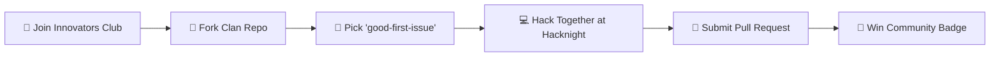

<div align="center">

<!-- Animated Header Banner -->


<p align="center">
  <b>The Mobile Development Wing of the Meru University Innovators Club (MUIC)</b><br/>
  <i>Crafting next-generation mobile experiences across native Kotlin and cross-platform Flutter.</i>
</p>

<!-- Cute Status Pills -->
<p align="center">
  
  
  
  
</p>

<!-- Dynamic Typing Tagline -->
<a href="https://github.com/Android-Community-MUST">
  
</a>

</div>

---

## 🌟 Who We Are

Welcome to **Android Community MUST**, operating proudly under the umbrella of the **Meru University Innovators Club (MUIC)** at Meru University of Science and Technology.

We bring together mobile engineers, designers, and innovators divided into two sister clans:
* 🤖 **KDroiders:** The Kotlin and Jetpack Compose tribe building deep, native Android apps.
* 🐦 **FDroiders:** The Flutter and Dart crew shipping blazing-fast, beautiful cross-platform apps.

```
   ┌─────────────────────────────────────────────────────────────┐
   │            Meru University Innovators Club (MUIC)           │
   │               └── Android Community MUST                    │
   │                                                             │
   │        🤖 KDroiders Clan              🐦 FDroiders Clan     │
   │     Native Kotlin & Compose         Cross-Platform Flutter  │
   │                                                             │
   │      ⚔️ Parallel Builds  •  🌙 Hacknights  •  🏆 Hackathons │
   └─────────────────────────────────────────────────────────────┘
```

---

## 💡 How We Build: Parallel Project Labs

When our community identifies a problem worth solving, both clans take on the challenge:

* 🤖 **KDroiders build the Native Edition:** Harnessing Kotlin Coroutines, Jetpack Compose, Material 3, and native Android system APIs.
* 🐦 **FDroiders build the Flutter Edition:** Harnessing Dart, Riverpod/Bloc, custom widget painter trees, and instant Hot Reload velocity.

This parallel approach allows us to compare architectures, benchmark performance, share backend APIs, and learn the strengths of both worlds in real-world conditions!

---

## 🌙 Hacknights, Hackathons & Clan Battles

We do not just write code during lectures, we live for the thrill of building under pressure!

* ☕ **Campus Hacknights:** Overnight coding sessions in university labs, turning caffeine and bugs into working prototypes by sunrise.
* 🏆 **Competitive Hackathons:** Team MUST actively competes in regional, national, and global hackathons, carrying home trophies and practical solutions.
* ⚡ **Clan Showdowns:** Friendly time-boxed sprints pitting KDroiders against FDroiders to see who implements dynamic features faster and smoother.

---

## ⚔️ The Clan Roster

| 🤖 **KDroiders (Kotlin Tribe)** | ⚔️ **Showdown** ⚔️ | 🐦 **FDroiders (Flutter Clan)** |
| :--- | :---: | :--- |
| **Mascot**: *Droidy the Native Titan* 🛡️ | **Identity** | **Mascot**: *Dash the Sky Hummingbird* ⚡ |
| *"Why bridge when you can go 100% native?"* | **Battle Cry** | *"Why write it twice when you can hot-reload anywhere?"* |
| **Superpower**: Jetpack Compose, Coroutines, Low-level Android APIs | **Strengths** | **Superpower**: 60fps animations, instant Hot Reload, multi-device reach |
| **Weakness**: Waiting for Gradle builds to sync ☕ | **Kryptonite** | **Weakness**: Counting closing brackets `))))` 😅 |
| **Philosophy**: *"Zero compromise on native smoothness."* | **Mindset** | *"Velocity and visual flair first."* |

> 🤝 **The Innovators Pact:**  
> In the end, KDroiders and FDroiders share the same cloud backends, celebrate each other's pull requests, and innovate together under MUIC!

---

## 🛠️ Community Tech Arsenal

<div align="center">

### 🤖 KDroiders Armory
[](https://kotlinlang.org/)
[](https://developer.android.com/jetpack/compose)
[](https://developer.android.com/studio)
[](https://www.jetbrains.com/kotlin-multiplatform/)
[](https://kotlinlang.org/docs/coroutines-overview.html)

### 🐦 FDroiders Armory
[](https://flutter.dev/)
[](https://dart.dev/)
[](https://bloclibrary.dev/)
[](https://code.visualstudio.com/)
[](https://flutter.dev)

### ☁️ Shared Cloud, AI & Backend
[](https://firebase.google.com/)
[](https://deepmind.google/technologies/gemini/)
[](https://spring.io/)
[](https://developers.google.com/maps)
[](https://developer.safaricom.co.ke/)

</div>

---

## 🚀 Featured Project: HustleHub

<table>
  <tr>
    <td width="65%">
      <h3>🎓 HustleHub: Campus Marketplace</h3>
      <p>
        <b>HustleHub</b> is our flagship open-source solution created to organize the informal peer-to-peer student service economy at Meru University. It replaces chaotic group chats with a structured, verified student marketplace.
      </p>
      <ul>
        <li>✨ <b>AI Smart Search:</b> Natural language search powered by Google Gemini</li>
        <li>💬 <b>End-to-End Encrypted Chat:</b> Real-time messaging with ECDH + AES-256-GCM and audio notes</li>
        <li>📍 <b>Live Campus Map:</b> Interactive Google Maps showing student service providers near hostels</li>
        <li>💳 <b>M-Pesa Daraja:</b> Seamless campus payments and service requests</li>
        <li>🛡️ <b>Verified Student Shield:</b> Exclusive campus access via <code>@must.ac.ke</code> emails</li>
      </ul>
      <p>
        <a href="https://github.com/Android-Community-MUST/kotlin-hustlehub">
          
        </a>
      </p>
    </td>
    <td width="35%" align="center">
      
      <br/><br/>
      <code>Built with ❤️ by KDroiders</code>
    </td>
  </tr>
</table>

---

## 🐾 How to Join & Contribute

Whether you just set up your dev environment or you already ship apps, you are welcome here!



### Quick Start in 4 Easy Steps:
1. 🍴 **Fork & Clone** any project from [Android-Community-MUST](https://github.com/Android-Community-MUST).
2. 🌿 **Create a branch**: `git checkout -b feature/cute-new-button` or `git checkout -b fix/dash-flying-bug`.
3. 🧪 **Test & Format**: Run lint/detekt for Kotlin or `flutter analyze` for Flutter.
4. 📬 **Open a PR**: Tag the maintainers for review and feedback!

---

## 📊 Community Pulse & Activity

<div align="center">

<a href="https://github.com/Android-Community-MUST/kotlin-hustlehub">
  
</a>
&nbsp;
<a href="https://github.com/Android-Community-MUST/fixit-kotlin">
  
</a>

<br/><br/>

<a href="https://github.com/Android-Community-MUST/navigation2-navigation3-kotlin">
  
</a>
&nbsp;
<a href="https://github.com/Android-Community-MUST/build-your-own-x">
  
</a>

</div>

---

## 👥 Builders & Innovators

Shoutout to everyone pushing commits, testing builds, reviewing PRs, and participating in hacknights!

<div align="center">
  <a href="https://github.com/Android-Community-MUST/kotlin-hustlehub/graphs/contributors">
    
  </a>
</div>

---

## 📬 Connect With The Community

Got questions, want to partner for a hackathon, or join our next campus hacknight? Connect with us:

<div align="center">

[](https://chat.whatsapp.com/)
[](https://discord.gg/)
[](https://twitter.com/)
[](https://linkedin.com/company/)
[](mailto:android.community.kotlin.hustlehub@gmail.com)

<br/>

<sub><b>Android Community MUST</b> • Meru University Innovators Club (MUIC) • <i>"Innovating mobile solutions on campus and beyond."</i></sub>

<br/>

<!-- Footer wave -->


</div>
